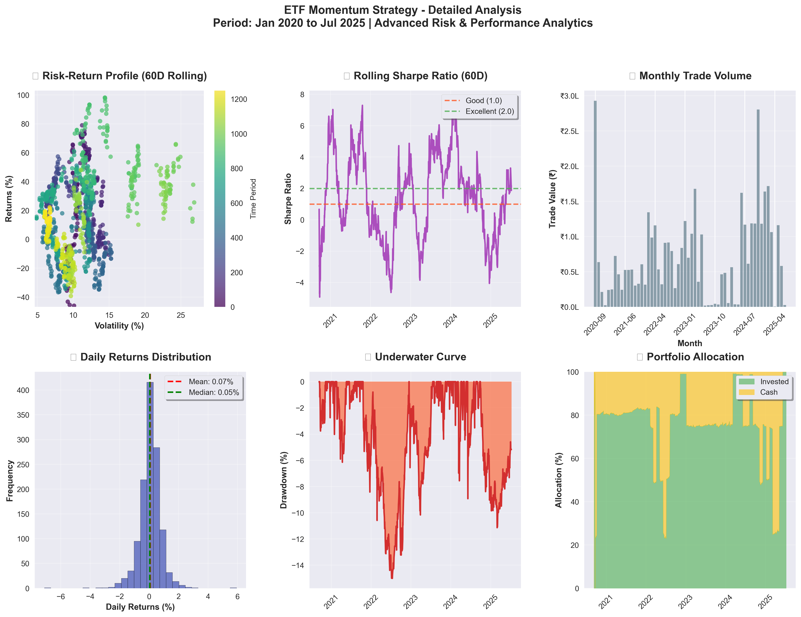
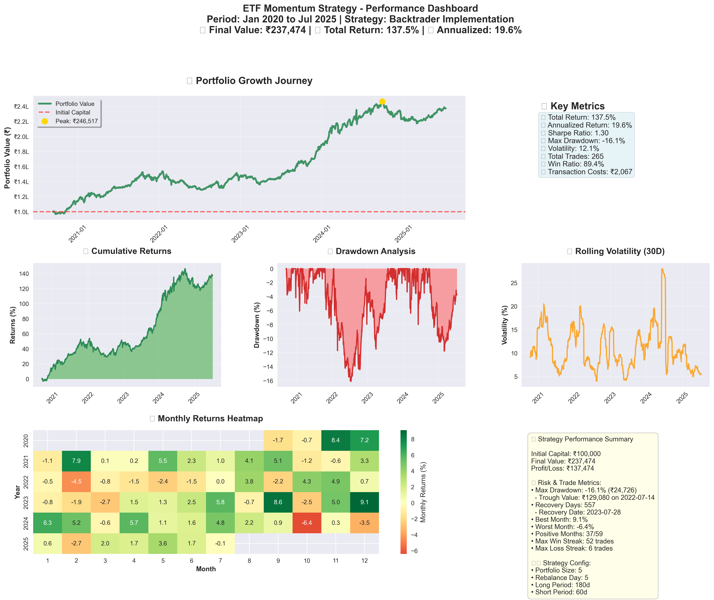

# Cross-Sectional ETF Momentum Strategy (NSE)

Systematic dual-timeframe cross-sectional momentum engine for liquid Indian NSE-listed ETFs, supporting live 5-ETF portfolio rotation (deployed via Smallcase/broker baskets), stateful holdings rebalancing, and multi-parameter `Backtrader` simulation with Indian statutory transaction costs and square-root market-impact slippage modeling.

---

## Quantitative Methodology

### 1. Dual-Horizon Momentum Score (`core.py`)
For each ETF $i$ in the liquid universe with at least `min_data_points = 200` trading days of history, the composite momentum score combines long-horizon trend persistence with medium-term acceleration:

$$\text{Score}_i = w_L \cdot R_{i, L} + w_S \cdot R_{i, S}$$

- **Long-term lookback ($L$):** `252` trading days (~12 months; configurable `180–252` days)
- **Short-term lookback ($S$):** `60` trading days (~3 months)
- **Default weights:** $(w_L, w_S) = (0.60, 0.40)$
- **Volatility-adaptive regime (`adaptive_weights=True`):** Shifts weights to $(0.50, 0.50)$ when 30-day annualized cross-sectional market volatility exceeds `20%`.

### 2. Regime Filters & Turnover Controls
Before ranking, candidate ETFs are screened through three filters:
- **Trend Filter (`50-EMA`):** Requires current adjusted close above its 50-day exponential moving average ($P_t > \text{EMA}_{50}$).
- **Retracement Filter:** Excludes ETFs whose drawdown from their rolling lookback peak exceeds `50%`.
- **Liquidity Filter (optional):** Enforces minimum 30-day average traded volume.
- **Equal-Weight Top-$N$ Selection & Rank-Buffered Exit:** Allocates equal weight (`20%` each for $N = 5$) to the top $N$ ranked ETFs on the 5th of each month. Existing holdings are retained until their cross-sectional rank falls below `exit_rank_buffer_multiplier × N` (`Rank > 10` for $N = 5$), reducing unnecessary monthly churn.

### 3. Statutory Transaction Costs & Market Impact (`TradingCostCalculator`, `MarketImpactModel`)
- **Indian Equity/ETF Delivery Cost Structure:** Models brokerage (`0.03%` capped at ₹20/order), sell-side STT (`0.025%`), NSE exchange turnover charges (`0.00325%`), SEBI regulatory fees, buy-side stamp duty (`0.003%`), and `18%` GST on brokerage + exchange fees.
- **Market-Impact Slippage Model:** Models execution slippage as a function of order volume participation ($Q / V_{\text{daily}}$) and realized volatility ($\sigma$):
  $$\text{Slippage} = \min\!\left(0.03,\; \left(c_{\text{lin}} \frac{Q}{V} + c_{\text{sqrt}} \sqrt{\frac{Q}{V}} + 0.02\sigma\right) \cdot \eta_{\text{dir}}\right)$$

---

## Backtest Evaluation (Jan 2020 – Jul 2025)

Evaluated over `2020-01-01` to `2025-07-09` (5.5 years) across the 13-ETF NSE universe using `Backtrader` (`backtrader_momentum_strategy.py`) and the native portfolio simulator (`etf_momentum_strategy.py`):

| Metric | Backtrader (`L=252, S=60, N=5`) | Parameter Sweep (`L=200, S=60, N=5`) |
| :--- | :--- | :--- |
| **Initial Capital** | ₹1,00,000 | ₹1,00,000 |
| **Final Portfolio Value** | ₹2,36,568 | ₹2,42,126 |
| **Cumulative Return** | `136.6%` | `142.1%` |
| **Annualized Return (CAGR)** | `19.5%` | `19.3%` |
| **Annualized Volatility** | `11.7%` | `11.7%` |
| **Sharpe Ratio** | `1.29` | `1.32` |
| **Maximum Drawdown** | `-16.1%` | `-12.1%` |
| **Total Rebalance Trades** | `265` | `265` |
| **Simulated Transaction Costs** | ₹2,067 | ₹2,005 |

### Strategy Performance Analysis



*Portfolio equity curve, return distribution, and rolling performance metrics (`2020-01-01` to `2025-07-09`).*

### Portfolio Risk & Drawdown Dashboard



*Cumulative returns, underwater drawdown profile, trade distribution, and risk diagnostics.*

---

## Installation & CLI Usage

```bash
cd momentum-etf
uv sync
```

### 1. Generate Target Top-5 Momentum Portfolio

```bash
uv run portfolio --amount 1000000
```

**Sample Output:**
```text
TODAY'S OPTIMAL ETF PORTFOLIO
Investment Amount: ₹1,000,000.00

TOP 5 MOMENTUM ETFS:
┌────────────────┬──────────┬─────────┬──────────────┬─────────────┐
│ 1. GOLDBEES    │ ₹80.53   │ 2,483   │ ₹199,956     │ 17.99%      │
│ 2. SILVERBEES  │ ₹103.79  │ 1,926   │ ₹199,900     │ 16.96%      │
│ 3. PSUBNKBEES  │ ₹79.50   │ 2,515   │ ₹199,942     │ 11.64%      │
│ 4. INFRAIETF   │ ₹96.63   │ 2,069   │ ₹199,927     │ 8.04%       │
│ 5. NIFTYBEES   │ ₹286.07  │ 699     │ ₹199,963     │ 7.21%       │
└────────────────┴──────────┴─────────┴──────────────┴─────────────┘
Cash Remaining: ₹312
```

### 2. Rebalance Existing Holdings (`JSON` or `CSV`)

```bash
uv run rebalance --holdings-file holdings.json --from-date 2024-01-01
```

**Holdings File Format (`holdings.json`):**
```json
[
  {"symbol": "NIFTYBEES.NS", "units": 350, "price": 120.50},
  {"symbol": "GOLDBEES.NS", "units": 200, "price": -1}
]
```
*(Setting `"price": -1` instructs the data provider to look up the historical adjusted close on `--from-date`.)*

### 3. Historical Point-in-Time Portfolio Reconstruction

```bash
uv run historical --from-date 2024-01-01 --to-date 2024-12-31 --amount 500000 --size 5
```

### 4. Multi-Parameter Backtest Sweep

```bash
uv run backtest --portfolio-sizes 5 --exit-rank-buffers 2 --long-term-periods 200 --short-term-periods 60 --initial-capitals 100000 --start-date 2020-01-01 --end-date 2025-07-09
```

---

## Liquid NSE ETF Universe (13 Instruments)

| Category | Ticker (`.NS`) | Underlying Benchmark / Exposure |
| :--- | :--- | :--- |
| **Broad Large-Cap** | `NIFTYBEES` | Nifty 50 Index |
| **Large/Mid Growth** | `SETFNN50` | Nifty Next 50 Index |
| **PSU Banking** | `PSUBNKBEES` | Nifty PSU Bank Index |
| **Precious Metals (Gold)** | `GOLDBEES` | Domestic physical gold bullion |
| **Precious Metals (Silver)** | `SILVERBEES` | Domestic physical silver bullion |
| **Healthcare / Pharma** | `PHARMABEES` | Nifty Pharma Index |
| **Information Technology** | `ITBEES` | Nifty IT Index |
| **Automotive** | `AUTOBEES` | Nifty Auto Index |
| **Infrastructure** | `INFRAIETF` | Nifty Infrastructure Index |
| **Consumption** | `CONSUMBEES` | Nifty India Consumption Index |
| **Dividend Factor** | `DIVOPPBEES` | Nifty Dividend Opportunities 50 Index |
| **Rules-Based Screen** | `SHARIABEES` | Nifty50 Shariah Index |
| **Public Sector Enterprises** | `CPSEETF` | Nifty CPSE Index |

---

## Configuration Reference (`StrategyConfig` in `core.py`)

```python
portfolio_size = 5                  # Number of ETFs held in equal-weight basket
exit_rank_buffer_multiplier = 2.0   # Retain holding until rank > portfolio_size * 2
rebalance_day_of_month = 5          # Monthly rebalance execution day
long_term_period_days = 252         # Long-horizon momentum window (trading days)
short_term_period_days = 60         # Short-horizon momentum window (trading days)
momentum_weights = (0.6, 0.4)       # (Long, Short) momentum weights
moving_average_period = 50          # EMA regime filter period
max_retracement_percentage = 0.50   # Max peak-to-trough drawdown filter
```

---

## Disclaimer

For quantitative research and educational purposes only. Historical backtest performance does not guarantee future live trading results.
